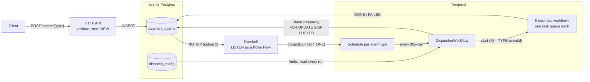

# Temporal Event Dispatcher

A proof of concept for turning payment events stored in Postgres into Temporal workflows without overloading Temporal's (Aurora Postgres) database. It implements both designs from the comparison page, so you can switch between them with one setting:

| `DISPATCH_MODE` | Option | What runs |
|---|---|---|
| `polling` (default) | 1 · Temporal Schedules **without** reactive streams | One Temporal Schedule per event type starts a generic `DispatcherWorkflow`, whose activity claims rows and starts workflows one at a time. |
| `reactive` | 2 · Temporal Schedules **with** reactive streams, built with Kotlin Flow | Same schedules and dispatcher. Adds a Postgres `NOTIFY` doorbell (JDBC `LISTEN` as a cold Kotlin Flow → `shareIn` → per-type `conflate()` → `schedule.trigger()`) and runs the claim-and-start loop as a Flow pipeline with bounded parallel starts. No Reactor, RxJava or Vert.x: only `kotlinx.coroutines`. |

**Comparison page:** <https://arunav-bhattacharya.github.io/temporal-dispatcher-poc/> (source: [`docs/index.html`](docs/index.html), deployed by `.github/workflows/pages.yml`). It walks through the naive loop, Option 1 and Option 2 with measured numbers, a live architecture diagram for each option (with per-schedule pause), backpressure, a throughput simulator and a weighted scorecard.

**Stack:** Kotlin 2.4 · Quarkus 3.40 · Postgres 17 · Exposed 1.6 · Temporal Java SDK 1.41 · kotlinx.coroutines 1.11

## How it works



1. **Events arrive over HTTP**: `POST /events/{type}` validates the JSON against the type's payload class (`400` if invalid) and stores one row in `payment_events` with status `NEW` (`202 Accepted`). The row moves `NEW → CLAIMED → STARTED → DONE | FAILED`, and the table is the source of truth.
2. **One Temporal Schedule per event type** (`dispatch-<TYPE>`). Overlap policy is SKIP and the catch-up window is one interval. `ScheduleSyncer` creates or updates schedules at startup and keeps their paused state.
3. **The dispatcher** reads limits from `dispatch_config`, claims at most `maxInflight − in-flight` rows with `SKIP LOCKED` and a lease, starts the business workflow (the workflow ID is derived from the event ID and duplicates are rejected), then marks the row `STARTED`. It stops when no rows remain or its time budget runs out. At the in-flight cap it waits for capacity inside the budget.
4. **Business workflows** run on their own task queues and mark their own row `DONE` or `FAILED`. A business failure, such as a sanctions hit or insufficient funds, marks the row `FAILED` instead of being retried forever.
5. **The reaper** repairs rows stuck in `STARTED` by asking Temporal what happened to the workflow.

The two engines are the only code that differs between the options:

- [`PollingDispatchEngine`](src/main/kotlin/com/payments/dispatch/dispatch/PollingDispatchEngine.kt): a plain loop with a blocking token bucket. Throughput ≈ `min(rate limit, 1 / start latency)`.
- [`ReactiveDispatchEngine`](src/main/kotlin/com/payments/dispatch/dispatch/ReactiveDispatchEngine.kt): `flow { claim; emit(batch) } → flatMapConcat → flatMapMerge(parallelism) { rateLimit; start; markStarted }`. The next batch is claimed only when the start stage has room. Throughput ≈ `min(rate limit, parallelism / start latency)`.

In both options the in-flight cap bounds open workflows: `starts/s ≤ maxInflight / workflow duration` (Little's law).

## Event types

| Event | Priority | Schedule | Doorbell (option 2) | Workflow | What it does |
|---|---|---|---|---|---|
| `INBOUND_PAYMENT` | 1 | 1m | on | `InboundPaymentWorkflow` | Sanctions screening → match the account → credit → notify. A watchlist hit fails the event. |
| `PAYMENT_RETURNED` | 2 | 1m | on | `ReturnedPaymentWorkflow` | Reverse the original posting. R01/R09 incur a return fee; R02/R03/R04 block ACH debits. |
| `PAYMENT_SCHEDULED` | 1 | 1m | off | `ScheduledPaymentWorkflow` | Validate → durable timer until `scheduledFor` → funds check → submit. The row becomes claimable 5 min before it is due. |
| `PAYMENT_POSTED` | 2 | 30s | off | `PostedPaymentWorkflow` | Ledger projection → available balance → notify. |
| `PAYMENT_SETTLED` | 2 | 5m | off | `SettledPaymentWorkflow` | Reconcile the fee → release the hold → close the payment. |

Priority 1 types are paused last when Temporal is under load (by ops today, by the future governor later); priority 2 types go first.

Payload classes are in [`Payloads.kt`](src/main/kotlin/com/payments/dispatch/events/Payloads.kt). To see one, call `curl localhost:8080/events/sample/INBOUND_PAYMENT`:

```json
{
  "inboundId": "INB-3560255790",
  "rail": "ACH",
  "amount": 10058.87,
  "currency": "USD",
  "originator": { "name": "Riverbend Veterinary Clinic", "accountNumber": "7932366210", "routingNumber": "061000104" },
  "beneficiaryAccountId": "ACC-77611466",
  "remittanceInfo": "Invoice INV-2026-53840",
  "referenceNumber": "121000247178946",
  "receivedAt": "2026-11-19T22:13:32.574778Z"
}
```

## Run it

Prerequisites: JDK 21+ and Docker.

```bash
docker compose up -d                       # events Postgres, Temporal's own Postgres, Temporal, UI on :8233
./gradlew quarkusDev                       # option 1 (polling)
DISPATCH_MODE=reactive ./gradlew quarkusDev   # option 2 (reactive)
```

Send one payment, then load and observe:

```bash
curl -X POST localhost:8080/events/INBOUND_PAYMENT -H 'Content-Type: application/json' \
  -d "$(curl -s localhost:8080/events/sample/INBOUND_PAYMENT)"   # 202 {"id":…,"status":"NEW"}
python3 scripts/watch_stats.py --generate INBOUND_PAYMENT:5000          # first pickup / all started / all finished
curl -X POST 'localhost:8080/events/burst?count=5000'                     # spread across all five types
curl localhost:8080/admin/stats
curl localhost:8080/admin/schedules
curl -X POST 'localhost:8080/admin/schedules/PAYMENT_RETURNED/pause?note=INC-4711'
curl -X POST 'localhost:8080/admin/schedules/PAYMENT_RETURNED/resume'
curl -X PUT localhost:8080/admin/limits/INBOUND_PAYMENT -H 'Content-Type: application/json' \
  -d '{"batchSize":200,"maxInflight":2000,"startsPerSecond":200,"parallelism":8,"timeBudgetSeconds":45,"leaseSeconds":120,"enabled":true}'
```

Temporal UI: <http://localhost:8233> (schedules `dispatch-*`, dispatcher runs, business workflows).

## Configuration

- **Static registry** ([`application.yaml`](src/main/resources/application.yaml), `dispatch.events`): interval, doorbell on/off and priority per event type. Changes are synced to Temporal Schedules at startup.
- **Runtime limits** (table `dispatch_config`, `GET/PUT /admin/limits`): `batch_size`, `max_inflight`, `starts_per_second`, `parallelism` (option 2), `time_budget_seconds` (~80% of the interval), `lease_seconds`, `enabled`. The dispatcher reads them at the start of every run, so changes need no redeploy.
- **Environment:** `DISPATCH_MODE`, `TEMPORAL_TARGET`, `TEMPORAL_NAMESPACE`, `EVENTS_DB_HOST/PORT/NAME/USER/PASSWORD`. Any key can be overridden the Quarkus way, e.g. `DISPATCH_SIMULATION_ACTIVITY_DELAY=10ms`.

## Measured on a laptop

5,000 `INBOUND_PAYMENT` rows inserted at once, same limits for both modes.

| Run A · dispatcher-bound (cap 20,000, 1,000/s, no activity delay) | Option 1 | Option 2 |
|---|---|---|
| First pickup after insert | 1.6 s (insert landed just before a tick; up to 60 s) | 0.4 s (doorbell) |
| Start rate | 123/s, one call at a time | 340/s, 8 in flight |
| All started | 40.6 s | 14.7 s |
| All finished | 117 s | 115 s |

| Run B · worker-bound (default limits, 10 ms activities) | Option 1 | Option 2 |
|---|---|---|
| Start rate | ≈ 85/s (in-flight cap) | ≈ 83/s (in-flight cap) |
| All finished | 172 s | 157 s |

Parallel starts help when the start call is the bottleneck. When workflows themselves are the bottleneck, both options settle at the in-flight cap's rate. In run B an earlier build of the doorbell (a Vert.x client missing a SCRAM library) had not connected, so option 2 fell back to interval ticks and lost nothing. The doorbell is now plain JDBC inside a Kotlin Flow: with default limits it picked up 2,000 inbound payments 0.3 s after the insert and started them all in 10.5 s, exactly the 200/s rate limit.

## Tests

```bash
./gradlew test
```

- `DispatchEngineTest`: one behaviour checklist run against both engines (in-flight cap, duplicates, releasing claimed rows after a failure, time budget), plus checks specific to the reactive engine (bounded concurrency, demand-driven claiming, speed-up).
- `PaymentWorkflowsTest`: workflow logic on Temporal's time-skipping test server, including a 3-day durable timer.
- `PaymentEventRepositoryTest`: `SKIP LOCKED`, leases, `available_at` and JSONB against real Postgres via Quarkus Dev Services (needs Docker).
- `PgNotificationsTest`: an insert fires the table trigger, and the doorbell's Kotlin Flow receives the event type.
- `IngestionApiTest`: `POST /events/{type}` returns 202 and stores NEW, rejects bad payloads and unknown types with 400, and delays future-dated payments.

## Project layout

```
src/main/kotlin/com/payments/dispatch/
  config/      AppConfig (@ConfigMapping), Temporal + Exposed producers, WorkerSetup
  events/      EventType, payloads, Exposed tables, repository, sample generator
  dispatch/    DispatcherWorkflow, Polling/ReactiveDispatchEngine, TokenBucket, ScheduleSyncer, reaper
  doorbell/    pgNotifications (LISTEN as a cold Flow) and Doorbell (shareIn → conflate → schedule trigger)
  workflows/   five business workflows + activities
  api/         /events (ingestion API, load generator, lookup) and /admin (stats, pause/resume, limits)
src/main/resources/db/migration/V1__payment_events.sql   tables, partial indexes, NOTIFY trigger
docs/index.html                                          comparison page (GitHub Pages)
scripts/watch_stats.py                                   timing helper
```

## Publishing

- **Code:** <https://github.com/arunav-bhattacharya/temporal-dispatcher-poc>
- **Comparison page:** <https://arunav-bhattacharya.github.io/temporal-dispatcher-poc/>. Pages is set to build from GitHub Actions, and the `pages` workflow redeploys `docs/` on every push that changes it.

## Notes and next steps

- `temporalio/auto-setup:1.29.7` is the last tag of that image. It is fine for local work. Production Temporal on Aurora uses the server and admin-tools images with your own schema setup.
- **Oracle source:** implement `EventStore` with Exposed's Oracle dialect. `ForUpdateOption.Oracle.ForUpdateSkipLocked` covers the claim, and a CLOB replaces the JSONB column type. The Flow pipeline works unchanged. The doorbell is Postgres-only, so Oracle types run on interval ticks.
- **Load governor (future):** a scheduled workflow that reads Temporal and Aurora metrics, lowers `dispatch_config` limits, then pauses schedules by priority, with hysteresis. It uses the same controls as `/admin`.
